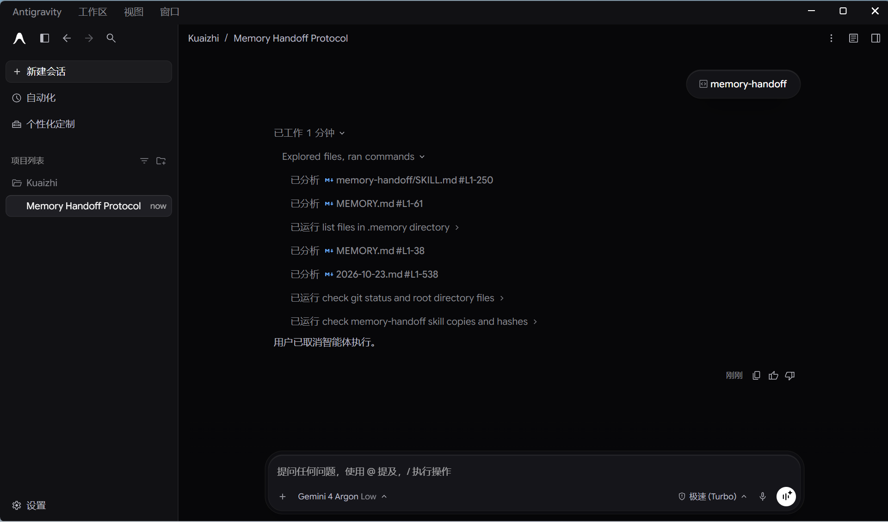
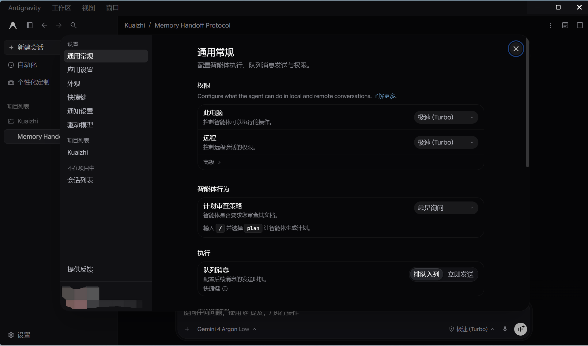

# Antigravity 汉化工具箱（便携版）

> 一个**完全离线、零依赖、U 盘即插即用**的 Google Antigravity 中文汉化工具。
> 双击两个 bat 之间切换：一键汉化，一键还原官方英文。

## 📸 汉化效果展示

以下是本工具箱汉化后的实际效果（真机截图）：

### 1. 主编辑器界面（左侧栏、菜单栏全中文）


### 2. 设置面板（通用常规、权限与智能体行为）


## ✨ 特性

- **便携免安装**：整个文件夹拷到 U 盘 / 网盘，复制到任何 Windows 电脑即可使用
- **零运行时依赖**：不需要安装 Node.js / Python，直接借用 Antigravity 自带的 Node 运行时执行汉化引擎
- **完全离线**：全程不联网，所有词典与打包器均内置在文件夹内（`node_modules/` 内置 `@electron/asar`）
- **一键安装 / 一键还原**：自动备份原版 `app.asar`，还原时无痕恢复官方英文
- **只动界面不动本体**：通过 ASAR 注入前端文件汉化界面文案，不修改程序二进制，不影响模型行为——AI 收到的始终是你的原始指令

## 🖥️ 环境要求

| 项目 | 要求 |
|------|------|
| 操作系统 | Windows 64 位 |
| 适用软件 | Google Antigravity 2.x（本机已验证 2.29.0） |
| 网络 | 无需联网 |
| 额外依赖 | 无 |

## 🚀 使用方法

### 安装汉化

1. 把**整个**「antigravity-cn-toolbox」文件夹复制到目标电脑（注意：不能只拷 `.bat` 文件）。
2. 确保已安装 Antigravity，并**完全退出**。
3. 双击 **`一键汉化.bat`**，等待提示"汉化完成"（约 10-60 秒，期间会自动关闭并重启 Antigravity）。
4. 重新打开 Antigravity，界面即为中文。

> 脚本会自动探测 5 个常见安装路径；若没找到，把 `Antigravity.exe` 直接拖进黑色窗口按回车即可。
> 常见位置：`C:\Users\你的用户名\AppData\Local\Programs\antigravity\Antigravity.exe`

### 还原英文

双击 **`一键还原.bat`** 即可恢复官方英文原版。

## 📂 目录说明

```
antigravity-cn-toolbox/
├── 一键汉化.bat           # 安装汉化入口
├── 一键还原.bat           # 还原官方英文入口
├── localization_engine.js # 汉化主程序（便携版，ASAR 解包/注入/重打包）
├── asar-run.cjs           # asar 打包器启动器
├── node_modules/          # 内置 @electron/asar（离线打包用，勿删）
├── 使用说明.txt            # 便携版速览说明
├── showimg/               # 汉化效果截图（README 引用）
└── dicts/                 # 中英对照词库（可自行补充）
    ├── common.json             # 公共词汇、侧边栏、登录页
    ├── menu_nav.json           # 系统与菜单栏
    ├── page_settings.json      # 设置面板
    ├── page_agents.json        # 智能体页
    ├── page_workspaces.json    # 工作区页
    ├── page_mcp_knowledge.json # MCP 服务器目录
    └── page_v2xx_patch.json    # 各版本增量词条补丁
```

## ✏️ 自定义词典

1. 打开 `dicts/` 下任意 JSON 文件，按如下格式追加一行（注意英文逗号）：

   ```json
   "Original English Text": "你的中文翻译"
   ```

2. 重新双击运行 `一键汉化.bat` 即可生效。

## 🛠️ 工作原理

1. 脚本通过 `ELECTRON_RUN_AS_NODE=1` 让 `Antigravity.exe` 以纯 Node 模式运行 `localization_engine.js`——这就是"免装 Node.js"的秘密。
2. 引擎自动关闭 Antigravity 进程，解包 `resources/app.asar`（首次运行自动备份为 `app.asar.bak`）。
3. 注入前端翻译脚本：基于 `MutationObserver` 动态监测并替换渲染层文本为中文，支持 Shadow DOM 穿透。
4. 重新打包 `app.asar` 并重启软件。左上角品牌名默认保留英文 Antigravity（`--brand-title english`）。

## ❓ 常见问题

**Q：提示"没有自动找到 Antigravity.exe"？**
A：把 `Antigravity.exe` 直接拖进黑色窗口后按回车。

**Q：需要装 Node.js / Python 吗？**
A：不需要。引擎借用 Antigravity 自带的 Node 运行时，完全离线可用。

**Q：Antigravity 官方更新后变回英文了？**
A：正常现象，官方更新会覆盖 `app.asar`。重新双击 `一键汉化.bat` 即可。

**Q：杀毒软件报毒？**
A：脚本会改写 `app.asar`，可能触发误报。可加入信任后运行；介意的话请核对 `localization_engine.js` 源码（纯本地文件操作，无任何联网行为）。

**Q：汉化后界面异常 / 打不开？**
A：双击 `一键还原.bat` 恢复；或手动把 `resources\app.asar.bak` 复制一份改名为 `app.asar` 覆盖回去。

## 📄 开源协议与声明

- 本项目基于开源项目 [qqxpee/antigravity2-cn](https://github.com/qqxpee/antigravity2-cn) 改造，按 **GPL-3.0** 协议开源。
- 词典成果部分来自 [yiheng8023/antigravity-chinese](https://github.com/yiheng8023/antigravity-chinese)（MIT 协议）。
- 本工具仅修改本地 Antigravity 应用的界面文案显示，不修改其核心二进制；Antigravity 及相关商标、软件权利归 Google 所有。仅供学习与个人本地化使用。
